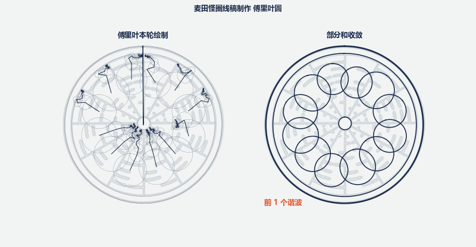
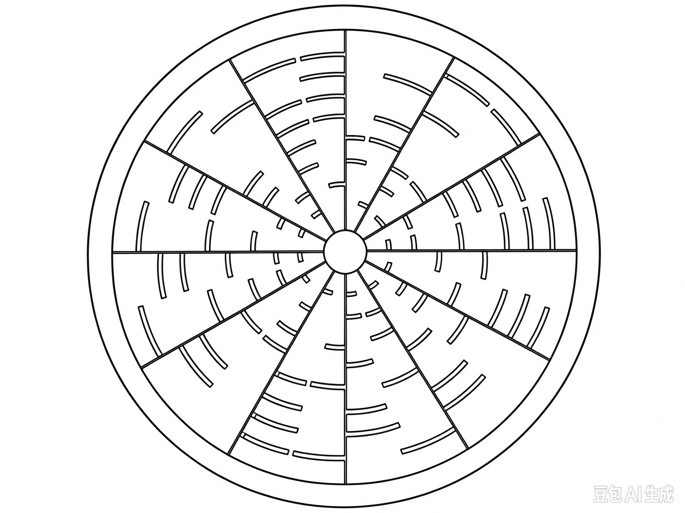
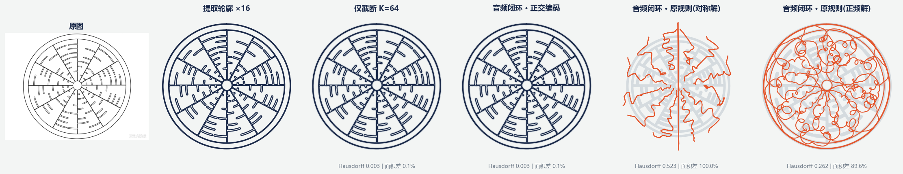
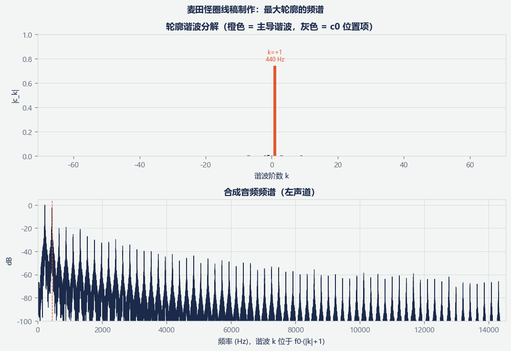

# fourier_plotter

> 图案 ⇄ 声波 双向转换器 · A bidirectional **pattern ⇄ audio** converter built on Fourier epicycles.

把一张闭合线稿分解成复傅里叶级数（一堆首尾相接、匀速旋转的"本轮"），
再把每个谐波系数 `c_k` 映射成一个正弦振荡器合成**立体声 WAV**；反过来，也能从这段音频
精确反解出系数、重建出图案。核心亮点：采用**正交立体声（quadrature）**编码时，图案 → 音频 → 图案
的闭环**近乎无损**。

---

## 效果展示

下面这条动画把示例图案的每条轮廓用傅里叶本轮实时"画"出来——左侧是旋转连杆链，
右侧是部分和随谐波数增加逐步收敛出细节：



| 输入线稿 | 原图 / 提取轮廓 / 音频重建对比 | 谐波分解与音频频谱 |
|:---:|:---:|:---:|
|  |  |  |

**示例音频**（quadrature 立体声，5 秒）：🔊 [`assets/euler_crop_circle.wav`](assets/euler_crop_circle.wav)
下载后用任意播放器打开即可听到图案的"声音"；也可以把它喂回工具反解成图案，验证可逆性：

```bash
python main.py --audio assets/euler_crop_circle.wav --mode quadrature --harmonics 64 --base-freq 220
```

> GitHub 的 README 不能内嵌播放器，故音频以文件链接提供；`epicycles.gif` 则在项目主页直接播放。

---

## 示例背景：欧拉恒等式怪圈（Wilton Windmill, 2010）

本例线稿复刻的是 2010 年出现在英国**威尔顿风车（Wilton Windmill）**附近的著名麦田怪圈，
它用图形编码了被誉为"最美数学公式"的**欧拉恒等式** $e^{i\pi}+1=0$：

- 一个大圆被 **12 条径向线**切分成 12 个扇区，外观如同一块放射状表盘；
- 每个扇区内部由若干段弧形短线组成，分别对应公式中的 $e$、$i$、$\pi$、$+1$、$=0$ 等元素；
- 整体是多层同心圆环 + 放射花纹的复杂曼陀罗结构。

这类"同心圆环 + 放射对称"的图案，恰好是傅里叶本轮的拿手好戏：圆环主要由低阶谐波 `c_{±1}` 主导，
放射花纹与尖角则由高阶谐波贡献——在频谱图上能清楚看到稀疏、等间隔的谐波峰。

---

## 原理

**1. 轮廓 → 复系数。** 图像经 Otsu 二值化、形态学清洗后用 `findContours` 提取所有闭合轮廓，
每条重采样为等弧长的复序列 $z(t),\ t\in[0,1)$，再做傅里叶级数：

$$z(t)=\sum_{k=-K}^{K} c_k\, e^{i2\pi k t},\qquad c_k=\int_0^1 z(t)\,e^{-i2\pi k t}\,dt$$

每一项 `c_k` 是半径 `|c_k|`、初相 `arg(c_k)`、每周期转 `k` 圈的旋转向量（`k>0` 逆时针、`k<0` 顺时针）。

**2. 系数 → 音频。** 每个谐波映射为一个正弦振荡器：

- 频率 $f_k = f_0\,(|k|+1)$
- 幅值 `|c_k|`，相位 `arg(c_k)`
- 多条轮廓依次占用时间片段，段间以静音分隔

两种立体声编码（`audio.py`）：

| 模式 | 左声道 | 右声道 | 可逆性 |
|---|---|---|---|
| `spec`（原规则） | `\|c_k\|\cos(\omega t+\varphi)` | `\|c_k\|\cos(\omega t-\varphi)` | ❌ 右声道是左的复共轭，`±k` 无法分离 |
| `quadrature`（正交） | `\|c_k\|\cos(\omega t+\varphi)` | `\mathrm{sgn}(k)\|c_k\|\sin(\omega t+\varphi)` | ✅ 两方程两未知数，严格可逆 |

正交模式与"示波器音乐"的 X/Y 同构：`c_{±m}=(P_L \pm i P_R)/2`。

---

## 安装

```bash
pip install -r requirements.txt   # numpy scipy opencv-python matplotlib Pillow
```

Python ≥ 3.10。

---

## 用法

```bash
# 图案 → 声波（自动生成 WAV + 闭环验证 + 可视化）
python main.py --image path/to/pattern.png [--harmonics 64] [--base-freq 220] [--duration 5.0] [--max-contours 16]

# 声波 → 图案
python main.py --audio path/to/sound.wav --mode quadrature [--harmonics 64] [--base-freq 220]

# 一键跑三个内置测试图案并生成误差报告
python main.py --demo
```

主要参数：

| 参数 | 默认 | 说明 |
|---|---|---|
| `--harmonics K` | 64 | 傅里叶阶数 `k=-K..K`；需 `2K+1 ≤ --points` 且 `f0·(K+1) < fs/2` |
| `--base-freq` | 220.0 | 基频 `f0`（Hz） |
| `--points` | 512 | 每条轮廓等弧长采样点数 |
| `--duration` | 2.5 | 音频总时长（秒）；轮廓多时需加大，保证每段 ≥ 0.15s |
| `--max-contours` | 8 | 最多编码的轮廓数（按面积从大到小） |
| `--smooth` | 1.0 | 周期高斯平滑 σ（采样点），0 关闭 |
| `--no-anim` / `--anim-format` | gif | 控制傅里叶本轮动画 |

---

## 输出文件

`--image` 模式在 `outputs/<图案名>/` 下生成：

- `<名>_quadrature.wav` / `<名>_spec.wav` — 两种立体声编码的音频
- `coefficients.npz` — 傅里叶系数
- `original.png` / `comparison.png` / `spectrum.png` / `recon_*.png` — 可视化
- `epicycles.gif`（或 `.mp4`）— 本轮动画
- `metrics.json` / `report.md` — 闭环误差指标与报告

## 项目结构

```
fourier_plotter/
├── main.py        # CLI 与闭环编排
├── contour.py     # 图像→二值掩膜→多轮廓，等弧长重采样/平滑/对齐，误差度量
├── fourier.py     # 复傅里叶系数、重建、主导谐波、旋转对称检测
├── audio.py       # 系数 ⇄ 立体声 WAV（spec / quadrature），静音分段与相量反解
├── visualize.py   # 本轮动画、对比图、频谱图
└── assets/        # 本 README 展示用资源
```

---

## 闭环精度（本示例实测）

16 条轮廓、`K=64`、`f0=220Hz`、时长 5s 下，"图案 → 音频 → 图案"的误差（单位：图案 RMS 半径）：

| 环节 | Hausdorff | 面积差 | 系数相对误差 |
|---|---|---|---|
| 仅 K=64 截断（不经音频） | 0.0026 | 0.11% | 0 |
| **音频闭环 · quadrature** | **0.0026** | **0.11%** | **4.9e-06** |
| 音频闭环 · spec（对称解） | 0.5227 | 100% | 0.53 |
| 音频闭环 · spec（正频解） | 0.2617 | 89.6% | 0.19 |

quadrature 与"仅截断"基线持平，说明音频往返几乎不丢信息；`spec` 的塌缩是其编码规则本身不可逆所致。

---

## 已知局限

- **绝对尺度不可恢复**：为防削波做了峰值归一化，重建差一个全局正实数倍（形状、相对位置与大小保留）。
- **`spec` 模式有损**：`c_m` 与 `c_{-m}` 落在同一频率无法分离；需可逆请用 `quadrature`。
- **K 阶截断**：`|k|>K` 的细节（尖角、细线）无法进入音频，表现为圆滑与 Gibbs 振铃。
- **细线/小特征过滤**：轮廓按面积阈值筛选，极小的放射细节默认可能被丢弃；复杂曼陀罗如需完整还原，
  应调低 `contour.extract_contours` 的 `min_area_frac` 并相应增大 `--duration`。
